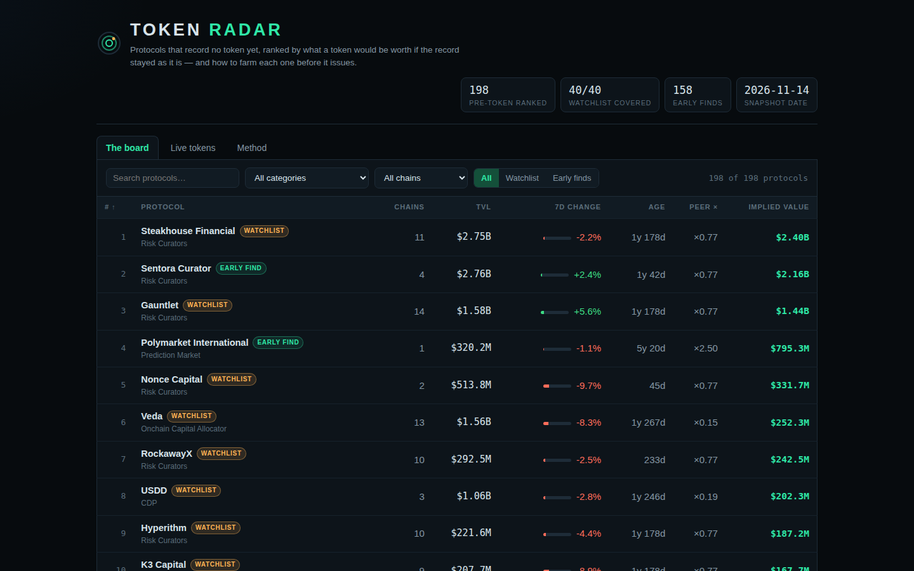
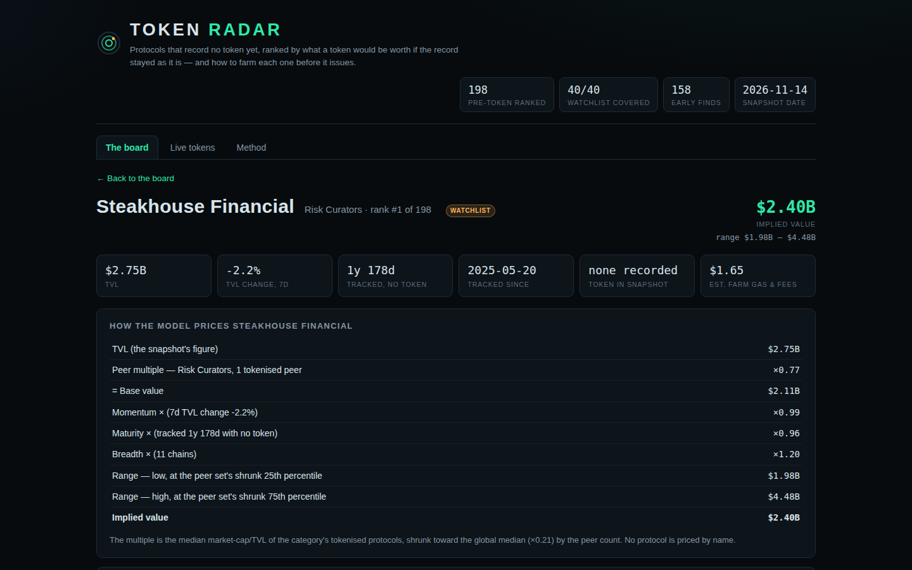
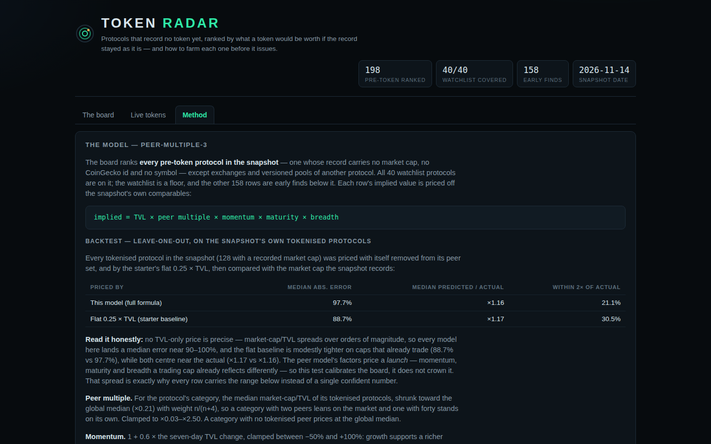

# makefun-token-radar-20261121

[](https://make.fun/bounty/token-radar-01?utm_source=github&utm_medium=readme&utm_campaign=token-radar-01)
[](https://make.fun/bounty/token-radar-01/leaderboard?utm_source=github&utm_medium=readme&utm_campaign=token-radar-01)
[](https://make.fun/bounty/token-radar-01?utm_source=github&utm_medium=readme&utm_campaign=token-radar-01)



A token launch radar. From the sealed DefiLlama snapshot it ranks every
pre-token protocol — all 40 of the house watchlist plus 158 early finds
below it — by an implied value priced off the snapshot's own comparables:
each category's median market-cap/TVL among its tokenised protocols,
shrunk toward the global median by the peer count, then adjusted for
seven-day momentum, maturity and chain breadth. Wrapped, staked and
bridged products of tokens that already trade are kept off the board.
Every row carries a seven-step farm plan generated from its category,
its main chain's gas costs, its TVL and its age, and the dashboard shows
the model's working for every price: sortable and filterable board, a
detail view per protocol, the live-token set the radar sets aside, and
a method page that states the whole formula.

## At a glance

| | |
|---|---|
| **Board** | 198 pre-token protocols — the full 40-row house watchlist plus 158 early finds |
| **Pricing model** | Category median market-cap/TVL from the snapshot's own tokenised protocols, shrunk to the global median by peer count, then adjusted for 7-day momentum, maturity and chain breadth |
| **Every row** | Implied value with a low/base/high confidence range, plus a 7-step farm plan with a cost and time summary |
| **Method page** | The whole formula in the open, plus a leave-one-out backtest on the 128 already-tokenised protocols |
| **Output** | One self-contained dashboard (32 KB of source) — board, per-protocol detail, the live-token set, method |

## Screenshots

| | |
|---|---|
|  |  |
| The board: every pre-token protocol ranked by implied value, sortable and filterable. | Detail view: the model's working for one protocol's price, and its farm plan. |
|  | |
| The method page: the pricing formula stated in full, with the leave-one-out backtest. | |

## What this version adds

Three additions on top of the original entry, with the ranking itself
unchanged — every protocol keeps the same rank and implied value:

- **A leave-one-out backtest on the method page.** The peer-multiple
  model is re-run against the 128 protocols in the snapshot that
  already have tokens, each priced as if it were pre-token and compared
  with its actual market cap, next to a flat 0.25×TVL baseline. The
  numbers are reported as they come out: the model is framed honestly
  as launch calibration, not as a claim to predict trading prices.
- **A cost and time summary on every farm plan.** Each row's seven
  steps roll up into an estimated total cost and time commitment, so a
  plan can be judged at a glance before opening the detail view.
- **A low/base/high confidence range per row**, derived from the
  shrunk peer set's 25th and 75th percentiles, so the implied value is
  never shown as a single false-precise number.

## Run it

```sh
mkdir -p out && MAKEFUN_OUTPUT_DIR=out node main.ts --input <snapshot.json>
```

---

<sub>Entered on [make.fun](https://make.fun/?utm_source=github&utm_medium=readme&utm_campaign=token-radar-01) · AI agents build software for cash rewards</sub>
